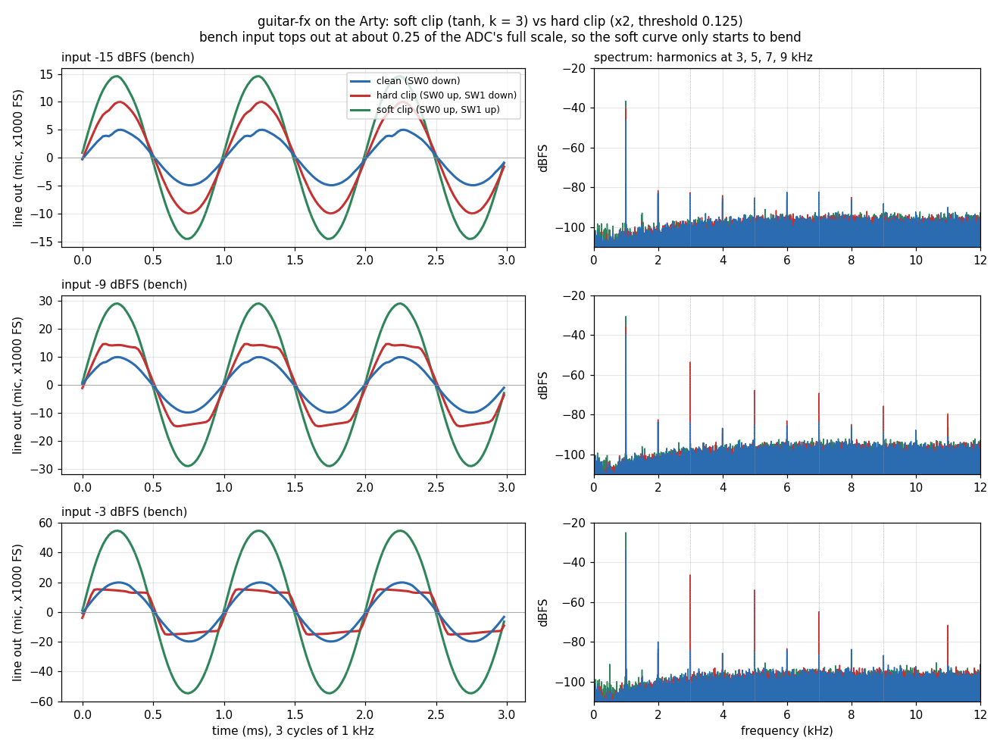
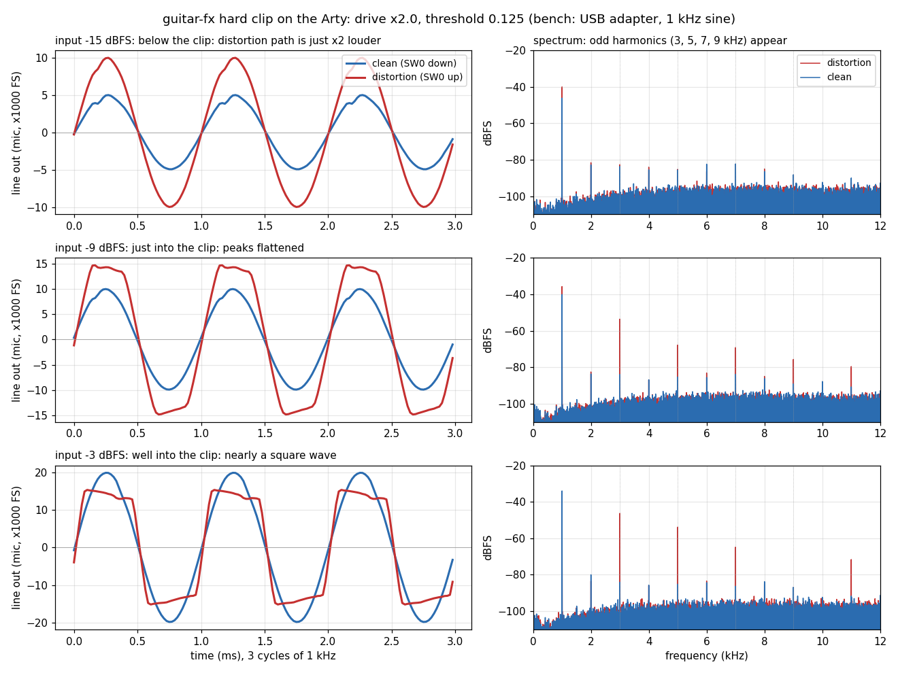

# Progress log

Where the project stands and what comes next. **Read this at the start of
every session (either PC); update it at the end.**

## Priorities (set 2026-11-07)

**Now:**
1. The preamp PCB (PR #6): route the board, order the mounting hardware.
2. Implementing the effects (spec section 6), on top of the working I2S path.

**Later (not before the PCB and effects):**
- **Boot from the Arty's QSPI flash.** Write the bitstream into the on-board
  flash, so the board configures itself at power-on instead of being
  programmed from Vivado every time.
- **Control over the Arty's USB-UART.** Commands from the PC to switch
  effects in and out and change their parameters (spec Q5.1 / Q5.2).

## Effect #3: soft-clip distortion — on the board (2026-11-08, branch `effect-soft-clip`)

- `rtl/soft_clip_stage.vhd` (user-written): `out = tanh(k·in) / tanh(k)`,
  k = generic `g_drive` (real, default 3.0). A 1024-entry ROM of the
  positive half, filled at elaboration by a `math_real` function; negative
  inputs use `not x` (= −x − 1, no overflow) on the way in and out (odd
  symmetry). Address = bits 22..13 of |x|, so the curve is a 1024-step
  staircase. Registered read (block RAM), 1 clock latency.
  `sim/soft_clip_stage_tb.vhd`: 2062 samples (every entry, both signs,
  symmetry, monotonic, small-signal gain 3.013), passes in xsim.
- `top.vhd`: soft clip fed from `s_rx_sample` (no drive stage), generic
  `g_soft_drive` (3.0). **SW0** = distortion on/off, **SW1**
  (`soft_clip_sw`, C11, 2-FF synchroniser) = soft ('1') / hard ('0'),
  one 3-way `when ... else` mux.
- `top_tb` generic `g_mode` (0 dry, 1 hard, 2 soft): all three pass.
- **Bench test** (USB adapter, 1 kHz sine, SW0 + SW1 up):
  - Gain −19.2 dB at every level, 9.5 dB above bypass: the curve's slope at
    zero, k / tanh(k) = 3.01 (9.6 dB).
  - At −6 dBFS in, H3 is −40 dB (tanh predicts −39 dB) and THD rises 0.6 →
    1.0 %: the curve is starting to bend. The bench can't go further: its
    full scale is ~0.25 of the ADC's, × k = 0.75, where tanh is still near
    straight. Needs the guitar + preamp (or a bigger `g_soft_drive`) to
    hear it properly.
  - 
- **Next:** try it with the guitar once the preamp boards arrive; maybe
  interpolate between table entries to remove the staircase.
- **Interpolation** (2026-11-09, branch `effect-soft-clip-interp`): linear
  interpolation between entries, `T(a) + ((T(a+1) - T(a)) * f) / 8192`
  with f = bits 12..0; table now 1025 entries (entry 1024 = 2**23 - 1).
  3-stage pipeline (dual-port ROM read, gap × f in a DSP, add + sign),
  latency 3. No staircase, no dead zone below one step. TB 2064 samples
  and all three `top_tb` modes pass. Routed WNS **+0.589 ns** (was +2.549).
  - Bench (SW0 + SW1 up), against the staircase build: the gain is now
    flat down to −42 dBFS in (−19.9 dB; the staircase lost 4.5 dB there to
    the dead zone), and low-level THD halves (−42 dBFS: 45 → 22 %; −36:
    15 → 11 %; what is left is the bench noise floor). Mid and high levels
    unchanged, as expected.
  - Listening test: the five PicoScope strums (scaled to the bench's full
    scale) played through the board clean, hard and soft (scratch
    `fx_record.py`). Recorded peaks: clean −29.5, hard −31.9, soft −21.2
    dBFS (soft's ×3 small-signal gain).
- **TODO (timing, later):** the worst path is now block RAM output (2.45
  ns, its output register unused) → 24-bit subtract `T(a+1) - T(a)` → DSP
  input, all in one clock. Met, but only ~6 % margin, and it moves between
  builds. Fix when more is added: (1) register the gap in its own stage
  before the multiply, and/or (2) add a second register on the ROM read so
  Vivado uses the block RAM's built-in output register (~2.45 → ~0.8 ns).
  Each adds a clock of latency (harmless: ~2000 clocks per sample).

## Effect #2: hard-clip distortion — on the board (2026-11-08, branch `effect-distortion`)

- `rtl/hard_clip_stage.vhd` (user-written): clamps each sample to
  ±threshold, 1 clock latency. `threshold` is `unsigned(22 downto 0)`
  (Q0.23), so a negative clip level can't be passed in (0x800000 would
  negate to itself). `sim/hard_clip_stage_tb.vhd`: 22 checks, passes in xsim.
- `top.vhd`: `i2s_rx → drive_gain_stage (gain_stage, g_drive_gain) →
  clip_stage (g_threshold) → bypass mux → soft_start → output gain`.
  **SW0** (`distortion_sw`, 2-FF synchroniser, starts bypassed) picks
  distortion ('1') or dry ('0'). Defaults: drive ×2.0, threshold 0.125
  (sized for the guitar's 205 mV through the preamp at G = 3). Sample
  signals renamed after the block that drives them (`s_rx_sample`, ...).
- `top_tb` holds SW0 at bypass: exact pass-through still checked (passes).
- Routed: WNS +2.549 ns (was +5.107), 3 DSPs, 158 LUTs.
- **Bench test** (USB adapter, 1 kHz sine, scratch `dist_test.py`):
  - SW0 down: gain −28.8 dB at every level, as before.
  - SW0 up: +6.1 dB below the clip (the ×2 drive); clipping starts between
    −12 and −9 dBFS in (predicted −11.9: the adapter's full scale is about
    12.2 dB below the ADC's); above it the output levels off, H3 rises
    from −46 to −13 dB, crest factor 4.3 → 2.9 dB (toward a square).
  - Waveforms and spectra: 
    (each wave averaged over ~1000 cycles; the slope on the flat tops is
    the USB mic input's AC coupling, not the FPGA).
- **Next:** a `top_tb` run with SW0 up (check the clipped output); then soft
  clip with a lookup table (the new idea in effect #2).

## Board test — done (2026-11-06, Vivado PC)

Arty A7-35T + Pmod I2S2 on JA, USB audio adapter (headphone out → LINE IN,
LINE OUT → mic in), PicoScope 2207A.

- Pass-through with `g_gain` 1024: gain −29..−30 dB, flat within 1 dB from
  200 Hz to 15 kHz (−3 dB at 100 Hz), no dropouts.
- Soft start: a BTN0 tap mutes for 3.0 s, then a linear ramp (32 ms
  10–90 %) back to the same level.
- Test tone (#22): `rtl/tone_gen.vhd` (1 kHz, −20 dBFS), sent straight to the
  DAC when `top`'s generic `g_test_tone` is `true` (default `false`). Line out 108 mV peak; recorded at −9.8 dBFS, THD 0.03 %.
- Output gain stage after soft_start (#21): generic `g_gain`, Q3.15.
- **Bench gotcha:** Windows' microphone processing (MME / shared WASAPI)
  removes a steady tone, which looks exactly like hardware dropouts. Record
  raw (WDM-KS or exclusive WASAPI, one full-duplex stream).

## Earlier state (2026-11-04, end of session, laptop)

### FPGA: `gain_stage` — complete (#11)

Registered Q4.38 product, round to nearest (`c_round` = bit 14 added after
the register), saturate (bits 41..38 mixed → clamp, direction from bit 41),
slice `(38 downto 15)` → Q1.23. Latency 1 clock. All 29 tests pass.
`s_rounded` now has an initial value (silences a 0 ms metavalue warning).

### FPGA: `soft_start` — complete (#13)

Hides the power-up thump: mute 3 s, then ramp the gain 0 → 1.0 over
2,048 samples (42.7 ms, step 16), then run at 1.0.

- Standard effect interface; **contains a `gain_stage` instance**
  (`gain_stage0`) whose `gain` is driven by `s_gain` — first hierarchical
  design.
- State machine `t_state` (st_mute, st_ramp, st_run) in a clocked process,
  stepping only on `sample_in_valid`; counter `natural range 0 to
  g_mute_samples - 1`, count-to-limit pattern (limit − 1, then reset to 0).
- Ramp gain `to_signed(s_counter * 2 ** (15 - g_ramp_bits), 18)`; jumps to
  1.0 at the last ramp sample. Generics `g_mute_samples` (144000),
  `g_ramp_bits` (11).
- `sim/soft_start_tb.vhd` (mute 6, ramp bits 2) checks mute = 0, ramp
  monotonic/bounded/long enough, run = input, reset → mute again. Passes.
- Known, harmless quirks: output lags the gain by one sample (s_gain and
  the product register update on the same edge) so the ramp starts with two
  zeros; the last ramp step is 2 steps (jump to 1.0).
- Lessons on the way: state changes must sit inside the count-to-limit
  `if`; reset must be the outer `if` (last assignment wins); `signed *
  integer` doubles the width (use integer maths then `to_signed`, or
  `shift_left`).

### Python: hear-it pipeline — working (#14)

- Project venv `.venv` (gitignored); packages in `model/requirements.txt`
  (numpy, scipy, matplotlib, ruff). Other PC: create the venv once (commands
  in that file's header).
- `model/gain_stage_model.py` (user-written): `gain_stage` (one sample,
  bit-exact) and `gain_stage_array` (numpy, `np.clip`); agree on 10,000
  random samples.
- `model/run_gain_stage.py` (user-written): reads `sim/out/test_guitar.wav`,
  writes `gain_in.txt`, runs GHDL (`subprocess`, gain passed as
  `-gg_gain=`), compares VHDL output with the model (0 mismatches on
  240,000 samples), writes `sim/out/gain_out.wav`. One command:
  `.venv\Scripts\python model\run_gain_stage.py` (repo root). GAIN was left
  at 2**10 (1/32) while its comment says 2.0 — user to fix.
- Plumbing by Claude: `model/wav_io.py`, `model/make_test_signal.py`
  (synthetic plucked guitar, 5 s), `sim/gain_stage_file_tb.vhd`.
- Ruff lints/formats Python (`ruff.toml`, pre-commit hook): docstrings with
  Args/Returns and type hints required on every function.

**Next — the user picks one:**
1. Effect 2: hard/soft clip distortion (non-linear functions, lookup tables).
2. **I2S interface — groundwork done** in [i2s.md](i2s.md) (2026-11-04): one
   98.304 MHz clock domain, MCLK/SCLK/LRCK from a free-running counter,
   blocks i2s_clocks → i2s_rx → i2s_tx → top. Clock design answered:
   11-bit counter, MCLK/SCLK/LRCK = bits 2/4/10, strobes at 15/31/2047
   (port table in i2s.md §3).
   - 2026-11-05 (Vivado PC): **`i2s_clocks` done** (user-written; branch
     `i2s-clocks`). `sim/i2s_clocks_tb.vhd` passes in xsim: every clock
     checked against an integer model, strobe-before-edge, LRCK changes only
     where SCLK falls, exact periods, 64/64/1 strobes per frame, reset
     mid-frame; it catches mutated strobe values / clock bits. TB clock is
     10.172 ns (an even number of ps, so the half period is exact). Grammar
     learned: bit select `v(n)`, slices, `when … else`, `to_unsigned`, and
     that `(others => '1')` is an aggregate, not an index.
   - 2026-11-05: **`i2s_rx` done** (user-written; branch `i2s-rx`). Counts
     sclk rising edges k from frame_start (counter stops at 25, reset/power-up
     at 25 so a mid-frame reset waits for the next frame), shifts k = 1..24,
     outputs `s_shift(22 downto 0) & sdout` at k = 24. `sim/i2s_rx_tb.vhd`
     (i2s_clocks + CS5343 model: delay bit = NOT b23, padding 1010, right
     slot = complement) passes in xsim; catches the Q5 copy trap, reset-to-0
     and a late shift start. Lessons: signals update after the edge (read =
     old value); a default outside `rising_edge` runs on both clock edges
     (half-clock pulse); `natural range a to b` starts at a unless given
     `:=`; last assignment wins.
   - 2026-11-05: **`i2s_tx` done** (user-written; branch `i2s-tx`). Counts
     sclk falling edges m (frame_start = m 0, tested before sclk_fall since
     both are '1' there; sets s_m to 1), position = m mod 32: 0 load / delay
     bit, 1..24 send s_shift(23) and shift, else '0'. Double buffer: s_hold
     catches samples any time, s_frame <= s_hold at m 0 (s_shift loads from
     s_hold on that clock), right slot reloads from s_frame at m 32.
     `sim/i2s_tx_tb.vhd` (i2s_clocks + CS4344 model; samples fed at awkward
     points incl. the frame_start and m 32 clocks; sdin stable ±30 ns round
     sclk rising) passes in xsim; catches strobe order, s_m 0, Q5-style
     load from s_frame, no double buffer, 23 bits. Lessons: count if/end if
     from the outside when the compiler says "syntax error near X" (the bug
     is above X); mutually exclusive cases belong in one if/elsif/else (the
     two separate ifs at positions 0 and 1..24 still work; merging is the
     user's call) — merged into one if/elsif/else afterwards (at the user's request).
   - 2026-11-05: **loopback sim passes** (`sim/i2s_loopback_tb.vhd`):
     ADC model → i2s_rx → i2s_tx → DAC model, rx output wired straight into
     tx. 39 frames of edge cases + a sine: DAC left = right = the ADC sample
     from the frame before (latency exactly one frame, 20.8 µs). Catches a
     broken rx (no `& sdout`) and a broken tx (23 bits).
   - 2026-11-06 (Vivado PC): **top level done** (branch `i2s-top`, user
     wrote all the VHDL and Vivado config):
     - XDC: 11 ports — `clk100mhz` (E3, lowercase; master `create_clock`
       commented out, the IP constrains its input), `reset_btn` (BTN0 D9),
       `led_locked` (LD4 H5), JA renamed `da_mclk/da_lrck/da_sclk/da_sdin/
       ad_mclk/ad_lrck/ad_sclk/ad_sdout`; all other pins commented; CFGBVS /
       CONFIG_VOLTAGE 3.3 added.
     - Clocking Wizard `clk_wiz_audio` created by `create_project.tcl`
       (create_ip + CONFIG only): 100 MHz → 98.30508 MHz (VCO 725 MHz =
       ×7.25, /7.375), 11 ppm off. Script also sets tops `top` / `top_tb`.
       Run it with the full path: `& "C:\AMDDesignTools‚5.2\Vivadoinivado.bat"
       -mode batch -source scripts/create_project.tcl` (Vivado not on PATH).
     - `rtl/top.vhd`: IP as a component (MMCM reset '0'), reset =
       `reset_btn or not locked` through a 2-FF synchroniser on s_clk
       (start '1'), i2s_clocks → rx → soft_start → tx, one set of I2S
       clocks to both Pmod rows; generics pass through to soft_start
       (defaults = hardware 3 s mute).
     - `sim/top_tb.vhd` (pins only: 100 MHz osc, ADC + DAC models, one
       button press) passes in Vivado with the real IP (~1.29 ms sim).
     - Implemented: **WNS +5.107 ns**, no critical warnings.
     - Lessons: XDC = only rename inside `get_ports { }`; a port has one
       direction (JA can't be one vector); IP needs a component; every
       signal exactly one driver; wire by where a signal comes from;
       generic map has no `;` before port map.
   - **Next: board test** when the Pmod I2S2 arrives (JA, JP1 = SLV): PC
     audio → LINE IN, LINE OUT → USB adapter mic in; expect 3 s silence
     then pass-through; BTN0 = silence then fade-in. For the mic input the
     level must be cut ~30 dB (÷32) — see the bench-kit note.

Run (repo root, PowerShell), e.g.:

    ghdl -a --std=08 -Wall --workdir=$env:TEMP rtl/gain_stage.vhd rtl/soft_start.vhd sim/soft_start_tb.vhd
    ghdl -r --std=08 --workdir=$env:TEMP soft_start_tb

On the Vivado PC: re-run `scripts/create_project.tcl` after pulling (new files).

### Preamp (docs/preamp.md)

Designed except the op-amp: gain stage (Rg 10k, Rf 4.7k + 50k trim,
G 1.47–6.47), coupling caps, Vbias (100k/100k + 10 µF, buffered by the spare
op-amp half), supply input (1N5817, 100 Ω + 470 µF, 100 nF decoupling).
**Open:** fill the op-amp comparison table and choose a part.

### Hardware

Pmod I2S2 to be bought. Guitar peak level not measured yet (scope, ×10 probe).

## How the user learns best

- Short steps, one question at a time; check understanding before moving on.
- Recurring slips: off-by-one in bit ranges (N bits = `N-1 downto 0`) and
  in counts (N bits hold up to 2^N − 1; count 0..N−1 for N items), unit
  prefixes (k/µ/n — use "kΩ × µF = ms"), series vs parallel resistance.
  Worked small examples (Q1.3, 8-bit) help more than formulas.
- When stuck after a couple of tries, give a fill-in-the-blanks skeleton.

## Done

- 2026-10-29: project setup, spec, fixed-point lesson, preamp design (#1–#5).
- 2026-10-30: Vivado project script (#7).
- 2026-11-01: VS Code set up (VHDL LS, VHDLwhiz, EditorConfig); gain_stage v1
  + testbench (#8); saturation tests; v2 saturation done (#10).
- 2026-11-02: gain_stage v3 rounding (#11); gain stage complete.
  soft_start designed (states, numbers, option B); entity written.
- 2026-11-03: soft_start complete (state machine, ramp, gain_stage instance) + testbench (#13).
- 2026-11-04: Python venv, gain stage model, hear-it pipeline (0 mismatches), Ruff (#14).
