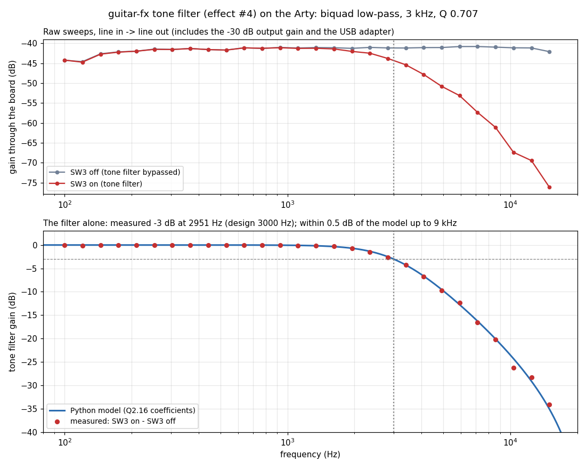
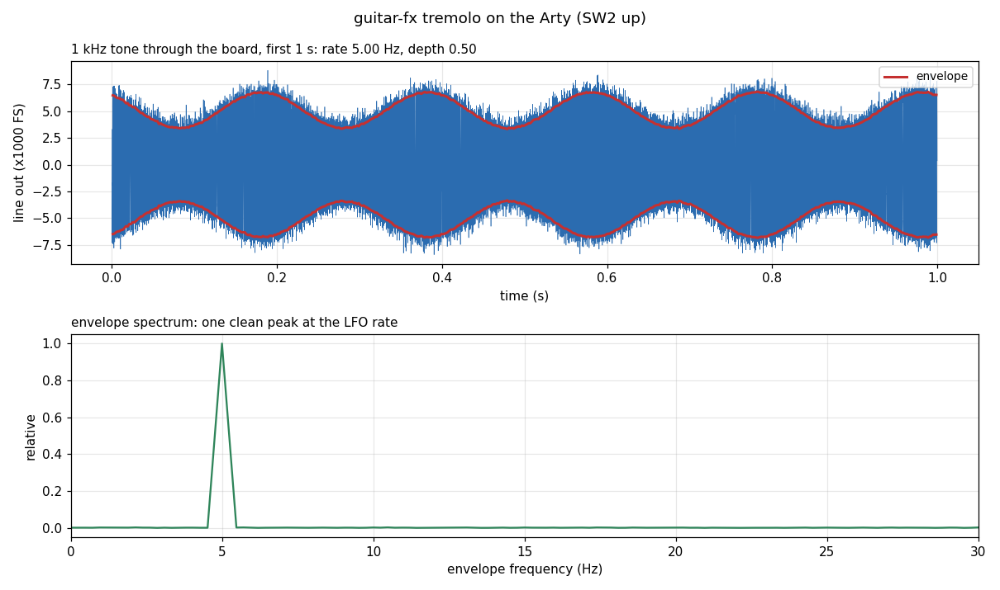
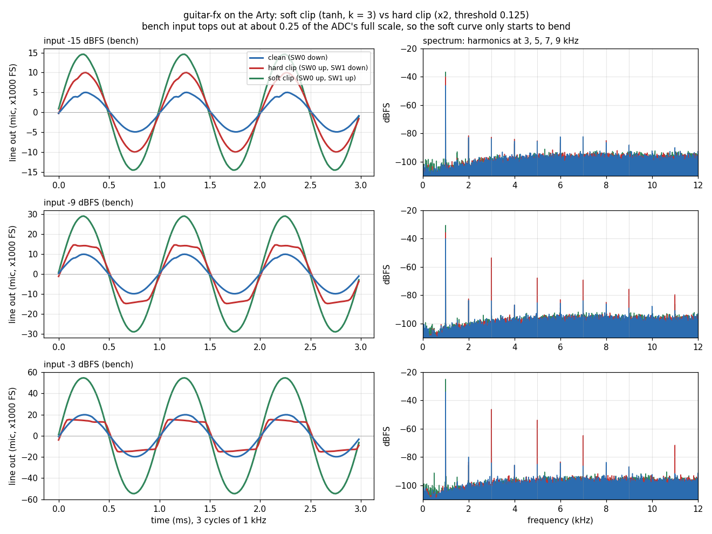
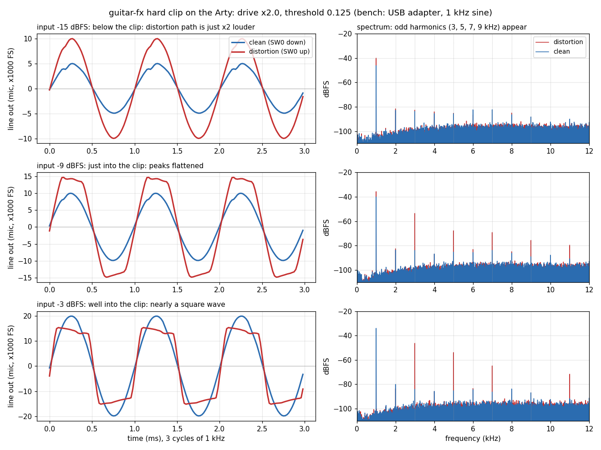

# Progress log

Where the project stands and what comes next. **Read this at the start of
every session (either PC); update it at the end.**

## Priorities (set 2026-11-07)

**Now:**
1. The preamp PCB (PR #6): route the board, order the mounting hardware.
2. Implementing the effects (spec section 6), on top of the working I2S path.

**Later (not before the PCB and effects):**
- ~~**Boot from the Arty's QSPI flash.**~~ Done 2026-11-09, see below and
  [qspi_boot.md](qspi_boot.md).
- **Control over the Arty's USB-UART.** Commands from the PC to switch
  effects in and out and change their parameters (spec Q5.1 / Q5.2).
  **Started 2026-11-13 (laptop):** groundwork in [uart.md](uart.md)
  (8N1 at 115 200 baud, blocks uart_tx -> uart_rx -> echo -> command
  decoder). Section 7 answered (A9 = FPGA in / D10 = out, 853 clocks per
  bit = +0.04 %, 2-FF sync for the async input, 86.8 us per byte ~ 4
  samples).
  - **`uart_tx` done** (user-written): 10-bit shift register loaded
    `'1' & data & '0'`, right shift filling '1', tx = bit 0, generic
    `g_clks_per_bit`. `sim/uart_tx_tb.vhd` (PC receiver model, 16 clocks
    per bit) passes: 7 bytes, start bit and busy length exact, valid
    while busy ignored, back-to-back, idle. Lessons: reset must be the
    outer if (counting outside it runs during reset and idle); VHDL
    range-checks every assignment, so `x + 1` at the limit fails even if
    a later line overrides it (put the increment in an `else`); `&`
    joins left to right, so `v(8 downto 0) & '1'` is a left shift.
    Header and comments added (Claude, on request).
  - **`uart_rx` done** (2026-11-14, user-written): 2-FF synchroniser
    (starts '1'), states idle / start (half bit, glitch check) / data (8 x
    full bit, shift in at the top) / stop (full bit: valid or
    frame_error pulse, back to idle mid-stop). `sim/uart_rx_tb.vhd` (PC
    transmitter model, 32 clocks per bit, line edges not clock-aligned)
    passes: 8 bytes, back-to-back, +/-3 % baud, glitch, framing error,
    reset mid-frame. Lessons: copying a limit from another state (half
    bit in st_data samples edges); an `else` that resets instead of
    counting hangs the state. Header by Claude (on request).
  - **Next: echo test on the board** (Vivado PC): uncomment the two
    UART pins in the XDC, wire uart_rx's byte + valid straight into
    uart_tx in top.vhd, type in a terminal at 115200 8N1. Question for
    the user first: can uart_tx ever be busy when a byte arrives?
    Answered yes (uart.md, echo section): back-to-back input from a PC
    even slightly faster than 115 246 baud drops bytes; typed keys are
    fine, pasted text may lose characters.
  - **`uart_fifo` done** (Vivado PC, branch `uart-fifo`): count-based
    circular buffer, show-ahead read, guarded write/read, overflow pulse;
    the branch also uncomments the UART pins in the XDC.
  - **`uart` wrapper done** (2026-11-15, laptop, user-written wiring):
    uart_rx straight out (rx_data / rx_valid / rx_frame_error);
    tx_data / tx_valid -> uart_fifo -> uart_tx; one line
    `s_fifo_rd_en = not empty and not busy` drives the FIFO's rd_en and
    uart_tx's data_in_valid. `sim/uart_tb.vhd` (end to end, echo in the
    TB) passes: typed echo, 24 pasted bytes from a PC 0.5 % fast, a
    20-byte burst (17 out in order, 3 dropped + tx_overflow). Lesson: the
    queue goes in front of the slow part (transmit), not the entrance.
    Header by Claude (on request).
  - **top.vhd done** (2026-11-15, user-written): ports uart_txd_in /
    uart_rxd_out, generic g_uart_clks_per_bit (853), one `uart_stage`,
    echo through s_uart_rx_data / s_uart_rx_valid. Header and comments by
    Claude. top_tb check 7 (Claude): "Hi!" + CR back-to-back after lock
    must echo in order (g_uart_clks_per_bit 16). Analyses in GHDL;
    **top_tb not yet run** (needs Vivado: Clocking Wizard IP).
  - ~~**Still to do (Vivado PC):** echo test in a terminal~~ superseded:
    the echo was replaced by PC control before it reached the board; the
    UART path was proved by the fx.py test instead (below).
  - **Command protocol decided** (2026-11-16, uart.md section 5): binary,
    3 bytes [register][value hi][value lo] from a Python script; replies
    ACK 0x06 / NAK 0x15 (unknown register) / CAN 0x18 (broken, resend);
    1 ms timeout (98 305 clocks, 17 bits); st_discard so a broken command
    gets exactly one CAN; Python resends on CAN or no reply (100 ms).
    Register 0x00 bit 7 = PC control vs board switches. Split into
    `cmd_decoder` (protocol) + `ctrl_regs` (meanings).
  - **`cmd_decoder` done** (laptop, user-written logic): states st_reg /
    st_hi / st_lo / st_discard, timer that stops at the top.
    `sim/cmd_decoder_tb.vhd` (fake ctrl_regs: 0x00..0x05 exist) passes
    all checks: good, unknown register, missing byte, bad byte + rest,
    bad byte + stream (one CAN), back-to-back, reset mid-command, resync.
    Header and comments by Claude (on request). Lessons: count if/end
    if from the outside; an output port with no driver gives no GHDL
    warning, only a silent block.
  - **Register reads added to the protocol** (user request, 2026-11-17):
    bit 7 of byte 1 = read; reply ACK + value hi + value lo. Status
    registers 0x10 (live state) and 0x7F (version), read-only.
  - **`ctrl_regs` done** (2026-11-17, user-written logic): registers
    0x00 control (bits 0..2 effects, bit 7 PC control), 0x01 output gain
    Q3.13, 0x02 drive Q3.13 (`& "00"` -> Q3.15), 0x03 threshold Q0.16
    (`& 7 zeros` -> Q0.23), 0x10 live, 0x7F version; register number =
    reg_addr(6 downto 0); combinational read process with defaults first
    (no latches); fx_* = PC bit or switch (mux on bit 7). Defaults = the
    pedal's fixed settings. `sim/ctrl_regs_tb.vhd` passes (defaults,
    decode, writes, read-only ignored, switches vs PC, version, reset).
    Header/comments by Claude. Lessons: GHDL only catches width / range
    mistakes when the sim runs; a port's width is set by what connects
    to it, pick bits inside with a slice; `16#10#` is a number, `x"10"`
    a bit string.
  - **cmd_decoder read path done** (2026-11-18, user-written logic): new
    inputs reg_addr_writable / reg_rdata; st_lo decides in order: not
    valid -> NAK; read flag -> snapshot reg_rdata into s_rd_data, ACK,
    st_rd_hi -> st_rd_lo (one byte each, consecutive clocks); writable ->
    write + ACK; else NAK. `sim/cmd_decoder_tb.vhd` reworked to log every
    reply byte; 12 tests incl. reads, read-only NAK, unknown read,
    write-then-read, and a snapshot check (fake register changes every
    clock; a decoder reading reg_rdata live fails it). Header by Claude.
    Lessons: `elsif` vs `else if`; a read needs no pulse (the value is
    always there), a write does; snapshot multi-byte values.
  - **Python control script done** (2026-11-18): `model/fx.py`. Steps
    1..3 user-written: gain <-> Q3.13 (round, range check, `& 0xFFFF` for
    negatives), threshold <-> Q0.16, `send_command` (3 bytes, retry on
    CAN / silence, NAK raises, read = ACK + 2 bytes), `write_reg` /
    `read_reg`. Step 4 (argparse: write / read / status, --port, --fake)
    and `model/fake_fpga.py` (cmd_decoder + ctrl_regs in Python, can lose
    a byte or a reply) by Claude. `fx.py` with no arguments = self-test.
    pyserial added to requirements (other PC: pip install -r again).
    Lessons: Ruff checks hints exist, not that they are true (read_reg
    returned bytes); a lost ACK makes the retry write twice, harmless.
  - **PC control wired into top.vhd** (2026-11-18, user-written): echo
    replaced by uart -> cmd_stage (cmd_decoder) -> ctrl_stage (ctrl_regs);
    defaults from top's generics `/ 2**2` (Q3.15 -> Q3.13) and `/ 2**7`
    (Q0.23 -> Q0.16); the muxes use s_fx_*, the gain stages and clipper
    s_out_gain / s_drive_gain / s_threshold. Header and comments by
    Claude. top_tb check 7 now sends reads (version, live, unknown) and
    checks ACK / value / NAK. **All four top_tb modes pass in GHDL** with
    a scratch stand-in for the Clocking Wizard (not in the repo: Vivado
    would see two clk_wiz_audio). VSG removes comments inside generic /
    port maps.
  - **✅ PC control works on the board** (2026-11-19, Vivado PC):
    create_project.tcl re-run (picks up the UART files); `top_tb` passes
    in all four modes with the real Clocking Wizard; bitstream WNS
    +0.722 ns (was 0.589; placement variation, the soft-clip TODO
    stands); `fx.py --port COMx status` and `write` both work on the
    Arty. Lessons: the project's sim runtime is `all`, so
    `launch_simulation` already runs top_tb to its `finish`; an extra
    `run all` restarts it past the end (index 63 out of `sent`'s 0..62).
    Close the sim before changing `g_mode` and clear the generic after.
    The `.venv` is per PC (gitignored): create it from
    model/requirements.txt on each machine.
  - **Next on the laptop (options, 2026-11-18):** ~~(1) tone filter~~
    done 2026-11-20, see Effect #5; (2) UART stage 2: tremolo rate/depth
    (and the tone filter's on/off bit) as ports + registers; ~~(3)
    soft-clip timing margin~~ done 2026-11-19, see the soft clip section.

## Effect #5: tone filter — on the board (2026-11-20, branch `effect-tone`)

(Spec section 6 calls it #4.) A biquad low-pass on SW3 (A10), after the
tremolo mux, before soft_start: tames the distortion's fizz.

- Theory, one question at a time: averaging = FIR low-pass; feedback =
  IIR (an impulse never quite dies); feedback > 1 = unstable; the biquad
  (2 past inputs, 2 past outputs: 12 dB/octave, Q); coefficients from the
  Audio EQ Cookbook; Q2.16 because a1 approaches -2.
- `model/biquad_model.py` (user-written, skeleton and main checks by
  Claude): `lowpass_coeffs`, `quantise` (Q2.16, range check after
  rounding), `plot_response` (exact vs Q2.16: identical at 3 kHz, +0.09 dB
  DC error at 300 Hz, so lower cutoffs or the 50 Hz hum notch need more
  fraction bits), and the bit-exact Direct Form I `biquad_q` (sum Q6.39 =
  45 bits, + 2**15, >> 16, clip). A step settles 1 LSB off: deadband from
  rounding in the loop, the hardware does the same.
- `rtl/tone_stage.vhd` (user-written, skeleton / header by Claude):
  generics `g_cutoff_hz`, `g_q`, `g_sample_rate`; coefficients worked out
  with math_real at build time (1963, 3926, 1963, -95302, 37618 at 3 kHz,
  same as Python); 5 DSPs; stage 1 products (42 bits), stage 2 sum (45
  bits, `resize` the first term), stage 3 round + saturate; the y state
  moves the clock after stage 3. Latency 3, samples >= 4 clocks apart.
  Bugs found on the way: product width off by one (`42 downto 0`); y
  shift nested inside stage 3's if (valid_2 and valid_3 never both '1':
  the feedback would stay 0, a FIR); y shift outside the reset's else.
- `sim/tone_stage_tb.vhd` (Claude): bit-exact model + Python's impulse
  and step numbers; full-scale steps overshoot and clip both ways; reset
  with a sample in flight; sines; 3000 random samples 4..12 clocks apart.
  5012 outputs pass; catches the nested-y-shift bug; also passes at 1 kHz
  Q 2.0 (+6.0 dB peak at the cutoff).
- `top.vhd` (user-written wiring, comments by Claude): `tone_filter` after
  the tremolo mux, `s_lowpass_sample` -> tone mux (SW3, synchronised) ->
  `s_eq_sample` -> soft_start; generics `g_tone_cutoff_hz` / `g_tone_q`.
  The test tone's instance and signals renamed `test_tone` /
  `s_test_tone_sample` (it was also called "tone"). Not in ctrl_regs yet.
- `top_tb` mode 4 (Claude): SW3 up, dry. A filter has memory, so a model
  process watches `s_mod_sample` inside top (external names), checks
  every filter output in place and records each frame's filtered value;
  the DAC must play exactly that. All five modes pass in xsim with the
  real Clocking Wizard. Vivado gotcha: tone_stage.vhd wasn't in the
  project at first ("not compiled in library xil_defaultlib"); re-run
  create_project.tcl after adding files.
- Build: WNS +1.602 ns (worst path still drive gain -> hard clip).
- **Bench** (USB adapter, stepped sweep -12 dBFS, SW3 on minus SW3 off):
  -3 dB at **2951 Hz** (design 3000), within 0.5 dB of the model from
  100 Hz to 9 kHz; noise floor scatter above 10 kHz.
  

## Effect #4: tremolo — on the board (2026-11-13, branch `effect-tremolo`)

(Spec section 6 calls it #3; this log already used #3 for the soft clip.)

- `rtl/tremolo_stage.vhd` (user-written): `gain = 1 - depth * (1 + sin) / 2`,
  `out = in * gain`, so the gain swings from 1.0 down to 1 - depth and never
  boosts.
  - LFO: a 32-bit phase accumulator, `c_step = rate * 2**32 / fs` (5 Hz:
    447 392), stepping once per sample; it wraps by itself, so it repeats
    with no reset logic and keeps its fractional remainder.
  - Sine table: 1024 × Q2.15, filled at build time; address = phase bits
    31..22.
  - Gain: a 5-register pipeline every clock (sine → (1 + sin) / 2 → × depth
    in a DSP → back to Q.15 → 1 - dip), into a `gain_stage` instance. No
    valid chain needed: the gain changes far slower than a few clocks.
  - Generics `g_rate_hz` (5.0), `g_depth` (0.5), `g_sample_rate` (48000.0).
- `sim/tremolo_stage_tb.vhd`: depth 0.5, 1.0 and 0.0 all pass (never above
  the input, right sign, first sample at 1 - depth/2, min / max, 480-sample
  period at 100 Hz, depth 0 bit-exact).
- `top.vhd`: tremolo after the distortion mux (a clipper would flatten it
  if it came first), its own bypass mux on **SW2** (`tremolo_sw`, C10, 2-FF
  synchroniser), generics `g_tremolo_rate_hz` / `g_tremolo_depth`.
  `top_tb` mode 3 checks the envelope (between 0.5 and 1.0 × dry, dipped and
  full-level frames both seen); modes 0..2 still bit-exact.
- **Bench** (1 kHz at −12 dBFS, SW2 up, SW0 down, scratch `trem_test.py`):
  rate **5.00 Hz**, depth **0.500** (6.0 dB swing), the envelope a clean
  sine. Its top matches the SW2-down level to 0.1 dB, so the gain really
  reaches 1.0. 
- Written to the QSPI flash: the board boots with all three switches.

## QSPI flash boot — done (2026-11-09, branch `qspi-boot`)

- The board boots from its QSPI flash (Micron MT25QL128,
  `mt25ql128-spi-x1_x2_x4`) at power-on, with the MODE jumper on.
- XDC: quad SPI, 33 MHz configuration clock, compression.
  `create_project.tcl` writes a `.bin` with every `.bit` (`-bin_file`).
- Image 408 KB (compression saved 14.3 Mbit of ~17.5), ~25 ms to load.
  Timing unchanged (WNS +0.589 ns).
- Tested after a power cycle: locked LED on, audio through at the usual
  bypass gain (−28.8 dB).
- How to update the flash: [qspi_boot.md](qspi_boot.md).

## Effect #3: soft-clip distortion — on the board (2026-11-08, branch `effect-soft-clip`)

- `rtl/soft_clip_stage.vhd` (user-written): `out = tanh(k·in) / tanh(k)`,
  k = generic `g_drive` (real, default 3.0). A 1024-entry ROM of the
  positive half, filled at elaboration by a `math_real` function; negative
  inputs use `not x` (= −x − 1, no overflow) on the way in and out (odd
  symmetry). Address = bits 22..13 of |x|, so the curve is a 1024-step
  staircase. Registered read (block RAM), 1 clock latency.
  `sim/soft_clip_stage_tb.vhd`: 2062 samples (every entry, both signs,
  symmetry, monotonic, small-signal gain 3.013), passes in xsim.
- `top.vhd`: soft clip fed from `s_rx_sample` (no drive stage), generic
  `g_soft_drive` (3.0). **SW0** = distortion on/off, **SW1**
  (`soft_clip_sw`, C11, 2-FF synchroniser) = soft ('1') / hard ('0'),
  one 3-way `when ... else` mux.
- `top_tb` generic `g_mode` (0 dry, 1 hard, 2 soft): all three pass.
- **Bench test** (USB adapter, 1 kHz sine, SW0 + SW1 up):
  - Gain −19.2 dB at every level, 9.5 dB above bypass: the curve's slope at
    zero, k / tanh(k) = 3.01 (9.6 dB).
  - At −6 dBFS in, H3 is −40 dB (tanh predicts −39 dB) and THD rises 0.6 →
    1.0 %: the curve is starting to bend. The bench can't go further: its
    full scale is ~0.25 of the ADC's, × k = 0.75, where tanh is still near
    straight. Needs the guitar + preamp (or a bigger `g_soft_drive`) to
    hear it properly.
  - 
- **Next:** try it with the guitar once the preamp boards arrive; maybe
  interpolate between table entries to remove the staircase.
- **Interpolation** (2026-11-09, branch `effect-soft-clip-interp`): linear
  interpolation between entries, `T(a) + ((T(a+1) - T(a)) * f) / 8192`
  with f = bits 12..0; table now 1025 entries (entry 1024 = 2**23 - 1).
  3-stage pipeline (dual-port ROM read, gap × f in a DSP, add + sign),
  latency 3. No staircase, no dead zone below one step. TB 2064 samples
  and all three `top_tb` modes pass. Routed WNS **+0.589 ns** (was +2.549).
  - Bench (SW0 + SW1 up), against the staircase build: the gain is now
    flat down to −42 dBFS in (−19.9 dB; the staircase lost 4.5 dB there to
    the dead zone), and low-level THD halves (−42 dBFS: 45 → 22 %; −36:
    15 → 11 %; what is left is the bench noise floor). Mid and high levels
    unchanged, as expected.
  - Listening test: the five PicoScope strums (scaled to the bench's full
    scale) played through the board clean, hard and soft (scratch
    `fx_record.py`). Recorded peaks: clean −29.5, hard −31.9, soft −21.2
    dBFS (soft's ×3 small-signal gain).
- **TODO (timing, later):** the worst path is now block RAM output (2.45
  ns, its output register unused) → 24-bit subtract `T(a+1) - T(a)` → DSP
  input, all in one clock. Met, but only ~6 % margin, and it moves between
  builds. Fix when more is added: (1) register the gap in its own stage
  before the multiply, and/or (2) add a second register on the ROM read so
  Vivado uses the block RAM's built-in output register (~2.45 → ~0.8 ns).
  Each adds a clock of latency (harmless: ~2000 clocks per sample).
  **Done (2026-11-19, option 1, user-designed):** new stage 2 registers
  the gap (with T(a), f, sign, valid copies); multiply in stage 3, add in
  stage 4; latency 3 -> 4 clocks. soft_clip_stage_tb (2064 samples) and
  top_tb mode 2 pass; **WNS +0.722 -> +1.608 ns**. Option 2 stays in
  reserve.
- **Next timing item (not needed yet, 1.608 ns = ~16 % margin):** the
  worst path is now drive_gain_stage -> hard clip: gain_stage registers
  only the multiply; its round (42-bit add), overflow check and saturate
  mux are combinational and share a clock with hard_clip_stage's two
  24-bit compares against ±threshold (now a ctrl_regs register, no longer
  a constant). Fix if it ever fails: register gain_stage's output after
  the saturate (+1 clock in every gain_stage: drive, output gain,
  tremolo; all valid-gated, so the TBs cope).

## Effect #2: hard-clip distortion — on the board (2026-11-08, branch `effect-distortion`)

- `rtl/hard_clip_stage.vhd` (user-written): clamps each sample to
  ±threshold, 1 clock latency. `threshold` is `unsigned(22 downto 0)`
  (Q0.23), so a negative clip level can't be passed in (0x800000 would
  negate to itself). `sim/hard_clip_stage_tb.vhd`: 22 checks, passes in xsim.
- `top.vhd`: `i2s_rx → drive_gain_stage (gain_stage, g_drive_gain) →
  clip_stage (g_threshold) → bypass mux → soft_start → output gain`.
  **SW0** (`distortion_sw`, 2-FF synchroniser, starts bypassed) picks
  distortion ('1') or dry ('0'). Defaults: drive ×2.0, threshold 0.125
  (sized for the guitar's 205 mV through the preamp at G = 3). Sample
  signals renamed after the block that drives them (`s_rx_sample`, ...).
- `top_tb` holds SW0 at bypass: exact pass-through still checked (passes).
- Routed: WNS +2.549 ns (was +5.107), 3 DSPs, 158 LUTs.
- **Bench test** (USB adapter, 1 kHz sine, scratch `dist_test.py`):
  - SW0 down: gain −28.8 dB at every level, as before.
  - SW0 up: +6.1 dB below the clip (the ×2 drive); clipping starts between
    −12 and −9 dBFS in (predicted −11.9: the adapter's full scale is about
    12.2 dB below the ADC's); above it the output levels off, H3 rises
    from −46 to −13 dB, crest factor 4.3 → 2.9 dB (toward a square).
  - Waveforms and spectra: 
    (each wave averaged over ~1000 cycles; the slope on the flat tops is
    the USB mic input's AC coupling, not the FPGA).
- **Next:** a `top_tb` run with SW0 up (check the clipped output); then soft
  clip with a lookup table (the new idea in effect #2).

## Board test — done (2026-11-06, Vivado PC)

Arty A7-35T + Pmod I2S2 on JA, USB audio adapter (headphone out → LINE IN,
LINE OUT → mic in), PicoScope 2207A.

- Pass-through with `g_gain` 1024: gain −29..−30 dB, flat within 1 dB from
  200 Hz to 15 kHz (−3 dB at 100 Hz), no dropouts.
- Soft start: a BTN0 tap mutes for 3.0 s, then a linear ramp (32 ms
  10–90 %) back to the same level.
- Test tone (#22): `rtl/tone_gen.vhd` (1 kHz, −20 dBFS), sent straight to the
  DAC when `top`'s generic `g_test_tone` is `true` (default `false`). Line out 108 mV peak; recorded at −9.8 dBFS, THD 0.03 %.
- Output gain stage after soft_start (#21): generic `g_gain`, Q3.15.
- **Bench gotcha:** Windows' microphone processing (MME / shared WASAPI)
  removes a steady tone, which looks exactly like hardware dropouts. Record
  raw (WDM-KS or exclusive WASAPI, one full-duplex stream).

## Earlier state (2026-11-04, end of session, laptop)

### FPGA: `gain_stage` — complete (#11)

Registered Q4.38 product, round to nearest (`c_round` = bit 14 added after
the register), saturate (bits 41..38 mixed → clamp, direction from bit 41),
slice `(38 downto 15)` → Q1.23. Latency 1 clock. All 29 tests pass.
`s_rounded` now has an initial value (silences a 0 ms metavalue warning).

### FPGA: `soft_start` — complete (#13)

Hides the power-up thump: mute 3 s, then ramp the gain 0 → 1.0 over
2,048 samples (42.7 ms, step 16), then run at 1.0.

- Standard effect interface; **contains a `gain_stage` instance**
  (`gain_stage0`) whose `gain` is driven by `s_gain` — first hierarchical
  design.
- State machine `t_state` (st_mute, st_ramp, st_run) in a clocked process,
  stepping only on `sample_in_valid`; counter `natural range 0 to
  g_mute_samples - 1`, count-to-limit pattern (limit − 1, then reset to 0).
- Ramp gain `to_signed(s_counter * 2 ** (15 - g_ramp_bits), 18)`; jumps to
  1.0 at the last ramp sample. Generics `g_mute_samples` (144000),
  `g_ramp_bits` (11).
- `sim/soft_start_tb.vhd` (mute 6, ramp bits 2) checks mute = 0, ramp
  monotonic/bounded/long enough, run = input, reset → mute again. Passes.
- Known, harmless quirks: output lags the gain by one sample (s_gain and
  the product register update on the same edge) so the ramp starts with two
  zeros; the last ramp step is 2 steps (jump to 1.0).
- Lessons on the way: state changes must sit inside the count-to-limit
  `if`; reset must be the outer `if` (last assignment wins); `signed *
  integer` doubles the width (use integer maths then `to_signed`, or
  `shift_left`).

### Python: hear-it pipeline — working (#14)

- Project venv `.venv` (gitignored); packages in `model/requirements.txt`
  (numpy, scipy, matplotlib, ruff). Other PC: create the venv once (commands
  in that file's header).
- `model/gain_stage_model.py` (user-written): `gain_stage` (one sample,
  bit-exact) and `gain_stage_array` (numpy, `np.clip`); agree on 10,000
  random samples.
- `model/run_gain_stage.py` (user-written): reads `sim/out/test_guitar.wav`,
  writes `gain_in.txt`, runs GHDL (`subprocess`, gain passed as
  `-gg_gain=`), compares VHDL output with the model (0 mismatches on
  240,000 samples), writes `sim/out/gain_out.wav`. One command:
  `.venv\Scripts\python model\run_gain_stage.py` (repo root). GAIN was left
  at 2**10 (1/32) while its comment says 2.0 — user to fix.
- Plumbing by Claude: `model/wav_io.py`, `model/make_test_signal.py`
  (synthetic plucked guitar, 5 s), `sim/gain_stage_file_tb.vhd`.
- Ruff lints/formats Python (`ruff.toml`, pre-commit hook): docstrings with
  Args/Returns and type hints required on every function.

**Next — the user picks one:**
1. Effect 2: hard/soft clip distortion (non-linear functions, lookup tables).
2. **I2S interface — groundwork done** in [i2s.md](i2s.md) (2026-11-04): one
   98.304 MHz clock domain, MCLK/SCLK/LRCK from a free-running counter,
   blocks i2s_clocks → i2s_rx → i2s_tx → top. Clock design answered:
   11-bit counter, MCLK/SCLK/LRCK = bits 2/4/10, strobes at 15/31/2047
   (port table in i2s.md §3).
   - 2026-11-05 (Vivado PC): **`i2s_clocks` done** (user-written; branch
     `i2s-clocks`). `sim/i2s_clocks_tb.vhd` passes in xsim: every clock
     checked against an integer model, strobe-before-edge, LRCK changes only
     where SCLK falls, exact periods, 64/64/1 strobes per frame, reset
     mid-frame; it catches mutated strobe values / clock bits. TB clock is
     10.172 ns (an even number of ps, so the half period is exact). Grammar
     learned: bit select `v(n)`, slices, `when … else`, `to_unsigned`, and
     that `(others => '1')` is an aggregate, not an index.
   - 2026-11-05: **`i2s_rx` done** (user-written; branch `i2s-rx`). Counts
     sclk rising edges k from frame_start (counter stops at 25, reset/power-up
     at 25 so a mid-frame reset waits for the next frame), shifts k = 1..24,
     outputs `s_shift(22 downto 0) & sdout` at k = 24. `sim/i2s_rx_tb.vhd`
     (i2s_clocks + CS5343 model: delay bit = NOT b23, padding 1010, right
     slot = complement) passes in xsim; catches the Q5 copy trap, reset-to-0
     and a late shift start. Lessons: signals update after the edge (read =
     old value); a default outside `rising_edge` runs on both clock edges
     (half-clock pulse); `natural range a to b` starts at a unless given
     `:=`; last assignment wins.
   - 2026-11-05: **`i2s_tx` done** (user-written; branch `i2s-tx`). Counts
     sclk falling edges m (frame_start = m 0, tested before sclk_fall since
     both are '1' there; sets s_m to 1), position = m mod 32: 0 load / delay
     bit, 1..24 send s_shift(23) and shift, else '0'. Double buffer: s_hold
     catches samples any time, s_frame <= s_hold at m 0 (s_shift loads from
     s_hold on that clock), right slot reloads from s_frame at m 32.
     `sim/i2s_tx_tb.vhd` (i2s_clocks + CS4344 model; samples fed at awkward
     points incl. the frame_start and m 32 clocks; sdin stable ±30 ns round
     sclk rising) passes in xsim; catches strobe order, s_m 0, Q5-style
     load from s_frame, no double buffer, 23 bits. Lessons: count if/end if
     from the outside when the compiler says "syntax error near X" (the bug
     is above X); mutually exclusive cases belong in one if/elsif/else (the
     two separate ifs at positions 0 and 1..24 still work; merging is the
     user's call) — merged into one if/elsif/else afterwards (at the user's request).
   - 2026-11-05: **loopback sim passes** (`sim/i2s_loopback_tb.vhd`):
     ADC model → i2s_rx → i2s_tx → DAC model, rx output wired straight into
     tx. 39 frames of edge cases + a sine: DAC left = right = the ADC sample
     from the frame before (latency exactly one frame, 20.8 µs). Catches a
     broken rx (no `& sdout`) and a broken tx (23 bits).
   - 2026-11-06 (Vivado PC): **top level done** (branch `i2s-top`, user
     wrote all the VHDL and Vivado config):
     - XDC: 11 ports — `clk100mhz` (E3, lowercase; master `create_clock`
       commented out, the IP constrains its input), `reset_btn` (BTN0 D9),
       `led_locked` (LD4 H5), JA renamed `da_mclk/da_lrck/da_sclk/da_sdin/
       ad_mclk/ad_lrck/ad_sclk/ad_sdout`; all other pins commented; CFGBVS /
       CONFIG_VOLTAGE 3.3 added.
     - Clocking Wizard `clk_wiz_audio` created by `create_project.tcl`
       (create_ip + CONFIG only): 100 MHz → 98.30508 MHz (VCO 725 MHz =
       ×7.25, /7.375), 11 ppm off. Script also sets tops `top` / `top_tb`.
       Run it with the full path: `& "C:\AMDDesignTools\2025.2\Vivado\bin\vivado.bat"
       -mode batch -source scripts/create_project.tcl` (Vivado not on PATH).
     - `rtl/top.vhd`: IP as a component (MMCM reset '0'), reset =
       `reset_btn or not locked` through a 2-FF synchroniser on s_clk
       (start '1'), i2s_clocks → rx → soft_start → tx, one set of I2S
       clocks to both Pmod rows; generics pass through to soft_start
       (defaults = hardware 3 s mute).
     - `sim/top_tb.vhd` (pins only: 100 MHz osc, ADC + DAC models, one
       button press) passes in Vivado with the real IP (~1.29 ms sim).
     - Implemented: **WNS +5.107 ns**, no critical warnings.
     - Lessons: XDC = only rename inside `get_ports { }`; a port has one
       direction (JA can't be one vector); IP needs a component; every
       signal exactly one driver; wire by where a signal comes from;
       generic map has no `;` before port map.
   - **Next: board test** when the Pmod I2S2 arrives (JA, JP1 = SLV): PC
     audio → LINE IN, LINE OUT → USB adapter mic in; expect 3 s silence
     then pass-through; BTN0 = silence then fade-in. For the mic input the
     level must be cut ~30 dB (÷32) — see the bench-kit note.

Run (repo root, PowerShell), e.g.:

    ghdl -a --std=08 -Wall --workdir=$env:TEMP rtl/gain_stage.vhd rtl/soft_start.vhd sim/soft_start_tb.vhd
    ghdl -r --std=08 --workdir=$env:TEMP soft_start_tb

On the Vivado PC: re-run `scripts/create_project.tcl` after pulling (new files).

### Preamp (docs/preamp.md)

Designed except the op-amp: gain stage (Rg 10k, Rf 4.7k + 50k trim,
G 1.47–6.47), coupling caps, Vbias (100k/100k + 10 µF, buffered by the spare
op-amp half), supply input (1N5817, 100 Ω + 470 µF, 100 nF decoupling).
**Open:** fill the op-amp comparison table and choose a part.

### Hardware

Pmod I2S2 to be bought. Guitar peak level not measured yet (scope, ×10 probe).

## How the user learns best

- Short steps, one question at a time; check understanding before moving on.
- Recurring slips: off-by-one in bit ranges (N bits = `N-1 downto 0`) and
  in counts (N bits hold up to 2^N − 1; count 0..N−1 for N items), unit
  prefixes (k/µ/n — use "kΩ × µF = ms"), series vs parallel resistance.
  Worked small examples (Q1.3, 8-bit) help more than formulas.
- When stuck after a couple of tries, give a fill-in-the-blanks skeleton.

## Done

- 2026-10-29: project setup, spec, fixed-point lesson, preamp design (#1–#5).
- 2026-10-30: Vivado project script (#7).
- 2026-11-01: VS Code set up (VHDL LS, VHDLwhiz, EditorConfig); gain_stage v1
  + testbench (#8); saturation tests; v2 saturation done (#10).
- 2026-11-02: gain_stage v3 rounding (#11); gain stage complete.
  soft_start designed (states, numbers, option B); entity written.
- 2026-11-03: soft_start complete (state machine, ramp, gain_stage instance) + testbench (#13).
- 2026-11-04: Python venv, gain stage model, hear-it pipeline (0 mismatches), Ruff (#14).
